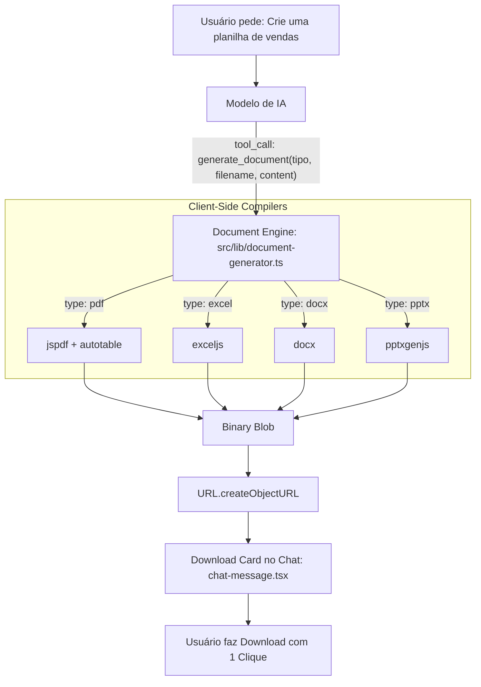

# Especificação de Design: Gerador Universal de Documentos Client-Side (PDF, Excel, Word, PPT)

- **Data:** 2026-10-11
- **Status:** Proposto
- **Autor:** Antigravity / Synap Core

---

## 1. Contexto e Motivação

Atualmente, o Synap gera apenas saídas de texto markdown no chat ou no editor de código. Quando os usuários solicitam relatórios, planilhas financeiras, contratos ou apresentações de slides, a IA não consegue entregar os arquivos prontos para uso em ferramentas de escritório (Excel, Word, PowerPoint, leitores de PDF).

O **Gerador Universal de Documentos** preenche essa lacuna com uma arquitetura 100% client-side (R$ 0,00 de custo de infraestrutura), permitindo que o navegador compile arquivos binários reais (`Blob`) e disponibilize botões de download instantâneo no chat.

---

## 2. Requisitos e Restrições

1. **Custo Zero Vitalício:** Geração 100% client-side na memória do navegador do usuário, sem chamadas a servidores de conversão pagos.
2. **Formatos Suportados:**
   - **PDF (`.pdf`):** Relatórios com cabeçalho, seções de texto e tabelas estilizadas (`jspdf` + `jspdf-autotable`).
   - **Excel (`.xlsx`):** Planilhas com múltiplas abas, cabeçalhos destacados e colunas ajustadas (`exceljs`).
   - **Word (`.docx`):** Documentos de texto com títulos, parágrafos e listas com marcadores (`docx`).
   - **PowerPoint (`.pptx`):** Apresentações com slides, títulos e bullet points (`pptxgenjs`).
3. **Privacidade Total:** Os dados do usuário não transitam para nenhum servidor de terceiros.
4. **Download Direto:** O usuário clica e salva o arquivo imediatamente na sua máquina através de `URL.createObjectURL()`.
5. **Tipagem e Build Estritos:** Zero erros no TypeScript (`tsc --noEmit`) e bundle Vite sem quebras.

---

## 3. Arquitetura da Solução



---

## 4. Detalhamento dos Componentes

### 4.1. Motor Gerador (`src/lib/document-generator.ts`)
Módulo com funções dedicadas para cada compilador:
- `generatePdfDocument(spec)`: cria documento PDF formatado com margens, títulos e tabelas automáticas.
- `generateExcelDocument(spec)`: cria workbook do ExcelJS com células estilizadas e larguras de coluna calculadas.
- `generateWordDocument(spec)`: cria documento Docx com cabeçalhos h1/h2 e listas com marcadores.
- `generatePptxDocument(spec)`: cria apresentação PPTX com slides de título e tópicos.
- Função orquestradora:
  ```typescript
  export async function generateDocumentBlob(spec: DocumentSpec): Promise<{
    blob: Blob;
    url: string;
    sizeBytes: number;
    filename: string;
    type: 'pdf' | 'excel' | 'docx' | 'pptx';
  }>;
  ```

### 4.2. Schema da Tool no Frontend (`src/App.tsx`)
```typescript
const DOCUMENT_GEN_TOOL = {
  type: 'function',
  function: {
    name: 'generate_document',
    description:
      'Gera arquivos reais para download nos formatos PDF, Excel (.xlsx), Word (.docx) ou PowerPoint (.pptx). ' +
      'Use SEMPRE que o usuário pedir para criar planilhas, relatórios, contratos, documentos ou apresentações de slides.',
    parameters: {
      type: 'object',
      properties: {
        type: {
          type: 'string',
          enum: ['pdf', 'excel', 'docx', 'pptx'],
          description: 'O tipo do documento a ser gerado.',
        },
        filename: {
          type: 'string',
          description: 'Nome do arquivo com extensão (ex: relatorio_2026.xlsx, proposta.pdf, contrato.docx, slides.pptx).',
        },
        title: {
          type: 'string',
          description: 'Título principal exibido no documento.',
        },
        content: {
          type: 'object',
          description:
            'Estrutura do conteúdo do documento. ' +
            'Para Excel: { sheets: [{ name, headers: string[], rows: any[][] }] }. ' +
            'Para PDF: { sections: [{ title?, text?, table?: { headers: string[], rows: any[][] } }] }. ' +
            'Para Word: { sections: [{ heading?, text?, bulletPoints?: string[] }] }. ' +
            'Para PPT: { slides: [{ title, subtitle?, bullets?: string[] }] }.',
        },
      },
      required: ['type', 'filename', 'title', 'content'],
    },
  },
};
```

### 4.3. Interface de Download no Chat (`src/components/chat-message.tsx`)
- Card visual atraente com cores padronizadas:
  - **PDF:** Vermelho Coral (`text-rose-400`, `bg-rose-950/20`, ícone `FileText`).
  - **Excel:** Verde Esmeralda (`text-emerald-400`, `bg-emerald-950/20`, ícone `Table` / `FileSpreadsheet`).
  - **Word:** Azul Cobalto (`text-sky-400`, `bg-sky-950/20`, ícone `FileText`).
  - **PowerPoint:** Âmbar/Laranja (`text-amber-400`, `bg-amber-950/20`, ícone `Presentation` / `Layers`).
- Informações no card:
  - Título e nome do arquivo formatados.
  - Tamanho real do arquivo (ex.: `38.4 KB`).
  - Botão de ação com ícone `Download`: "Baixar Arquivo".

### 4.4. Skill Nativa Integrada
- Nova habilidade adicionada ao catálogo padrão do Synap:
  - **ID:** `doc-creator`
  - **Nome:** *Office & PDF Architect*
  - **Descrição:** Especialista em formatação profissional de planilhas financeiras, relatórios PDF e apresentações.
  - **System Prompt:** Orienta o modelo a organizar dados em colunas limpas, criar seções legíveis e acionar `generate_document` com dados completos.

---

## 5. Critérios de Aceite e Verificação

1. **Testes Unitários:** Teste automatizado de validação de schemas e gerador de Blobs (`src/lib/document-generator.test.ts`).
2. **Tipagem Estrita:** `npm run lint` (`tsc --noEmit`) sem nenhum erro de tipo.
3. **Build de Produção:** `npm run build` bem-sucedido.
4. **Download Funcional:** Os 4 formatos compilam sem falhas no navegador.
