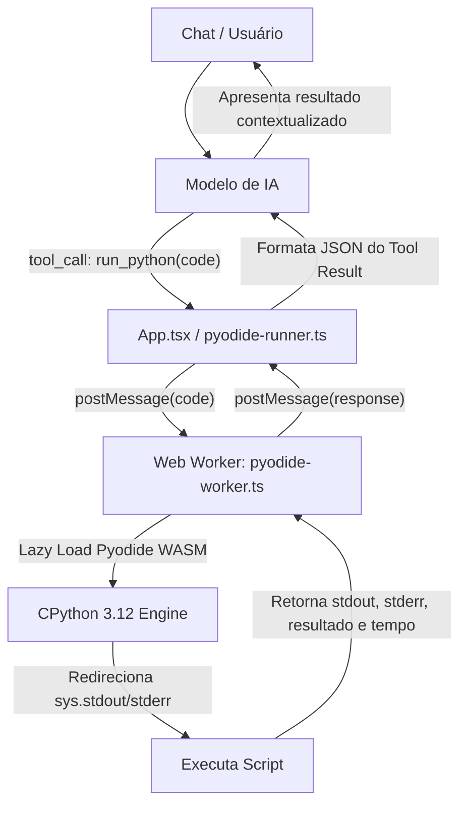

# Especificação de Design: Execução Real de Código Python (Pyodide WASM)

- **Data:** 2026-10-11
- **Status:** Proposto
- **Autor:** Antigravity / Synap Core

---

## 1. Contexto e Motivação

Atualmente, o Synap possui uma ferramenta de terminal (`run_terminal_command`) que opera apenas como um emulador conectado à API do GitHub (executando comandos virtuais como `git status`, `ls`, etc.), mas sem capacidade de executar código de verdade.

Para dar ao Synap capacidade real de cálculo matemático preciso, análise de dados, testes de algoritmos e execução de scripts sem custo algum e sem chaves de API, utilizaremos o **Pyodide** (Python 3 compilado para WebAssembly).

---

## 2. Requisitos e Restrições

1. **Custo Zero Vitalício:** Sem servidores dedicados, sem chaves de API de terceiros, sem limites de faturamento.
2. **Zero Congelamento de Tela (Non-blocking):** A execução deve rodar inteiramente em um **Web Worker**, garantindo que cálculos pesados não travem o chat ou a renderização do React.
3. **Zero Overhead Inicial no Bundle:** Carregamento dinâmico (*lazy-load*) dos binários do Pyodide sob demanda (apenas quando a primeira execução de Python for solicitada).
4. **Captura Estrita de I/O:** Capturar `sys.stdout` (`print(...)`) e `sys.stderr` com tratamento claro de exceções (Traceback).
5. **Timeout de Segurança:** Limite rígido de 15 segundos para abortar loops infinitos (`while True`).

---

## 3. Arquitetura da Solução



---

## 4. Detalhamento dos Componentes

### 4.1. Worker de Execução (`src/workers/pyodide-worker.ts`)
- Script dedicado de Web Worker nativo do Vite (`new Worker(new URL(...), { type: 'module' })`).
- Baixa o runtime do CDN oficial (`https://cdn.jsdelivr.net/pyodide/v0.26.4/full/pyodide.js`).
- Inicializa com `loadPyodide()`.
- Cria buffers customizados para capturar qualquer chamada a `print()` ou saídas de erro.
- Executa via `pyodide.runPythonAsync(code)`.

### 4.2. Gerenciador de Execução (`src/lib/pyodide-client.ts`)
- Singleton que gerencia a instância do Web Worker.
- Expõe método assíncrono:
  ```typescript
  export interface PythonExecutionResult {
    stdout: string;
    stderr: string;
    result?: string;
    executionTimeMs: number;
    error?: string;
  }

  export async function executePythonCode(code: string): Promise<PythonExecutionResult>;
  ```
- Gerencia promessas pendentes com timeout de 15 segundos.

### 4.3. Registro da Ferramenta (`src/App.tsx`)
- Declaração de `PYTHON_TOOL`:
  ```typescript
  const PYTHON_TOOL = {
    type: 'function',
    function: {
      name: 'run_python',
      description:
        'Executa scripts Python 3 reais no navegador via WebAssembly (Pyodide). ' +
        'Use SEMPRE para cálculos matemáticos complexos, estatística, testes de código, simulações ou manipulação de dados.',
      parameters: {
        type: 'object',
        properties: {
          code: {
            type: 'string',
            description: 'O script Python completo a ser executado.',
          },
        },
        required: ['code'],
      },
    },
  };
  ```
- Inclusão em `DEFAULT_CHAT_TOOLS` e `ALL_CHAT_TOOLS`.
- Integração em `executeTool` invocando `executePythonCode(args.code)`.
- Atualização do System Prompt para instruir a IA a usar `run_python` para matemática e lógica computacional.

### 4.4. Interface do Usuário (`src/components/chat-message.tsx`)
- Card visual dedicado para chamadas de `run_python`:
  - Durante a execução: `ThinkingOrb` (modo `composing`), badge "Executando Python (WASM)…".
  - Após a conclusão: Bloco de código com botão de cópia, saída de console (`stdout`/`stderr`) e tempo de execução (`ex: 142ms`).

---

## 5. Critérios de Aceite e Verificação

1. **Testes Automatizados:** Teste de interface do cliente e sanitização de scripts (`src/lib/pyodide-client.test.ts`).
2. **Tipagem e Lint:** `npm run lint` (`tsc --noEmit`) sem erros.
3. **Build de Produção:** `npm run build` gerando bundle limpo e sem warnings de chunking.
4. **Execução Real:** Script `print(2 + 2)` e cálculo matemático retornando o resultado exato pelo console.
