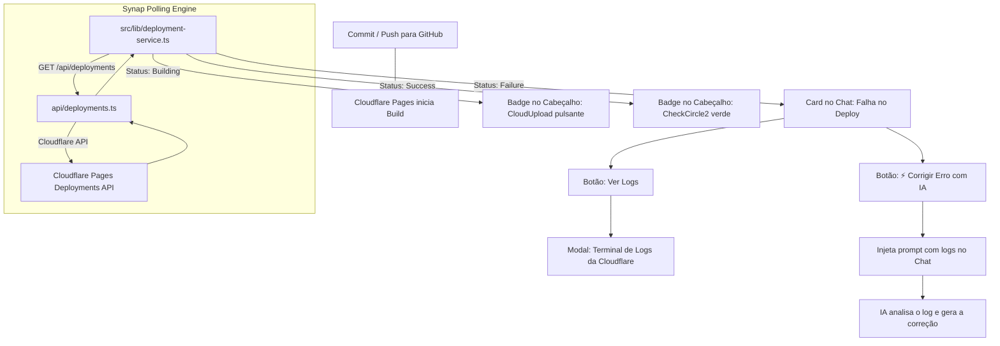

# Especificação de Design: Monitor de Deploy da Cloudflare & Correção Assistida por IA

- **Data:** 2026-10-15
- **Status:** Proposto
- **Autor:** Antigravity / Synap Core

---

## 1. Contexto e Motivação

O Synap permite editar arquivos e realizar commits diretamente no repositório GitHub (`Dante2526/Synap`), que engatilha o processo de CI/CD automatizado no **Cloudflare Pages** (projeto `synap`).

No entanto, quando ocorre qualquer falha de compilação ou build na Cloudflare (ex.: erro de TypeScript `tsc --noEmit`, pacote faltante, incompatibilidade de sintaxe ou estouro de limites), o usuário precisava abrir uma aba externa no painel da Cloudflare para identificar o erro.

Este recurso introduz:
1. **Monitoramento de Deploy em Tempo Real:** Acompanhamento do status do build da Cloudflare diretamente no painel do Synap com ícones refinados e modernos (sem círculos coloridos genéricos).
2. **Visualizador de Logs do Terminal:** Visualização das linhas exatas emitidas pelo `npm run build` na Cloudflare.
3. **Controle Estrito do Usuário & Ação Sob Demanda:** A IA **nunca** executa alterações sem ordem expressa. Ao detectar falha, o sistema exibe o card informativo com um botão destacado **[⚡ Corrigir Erro com IA]**. Somente após o clique do usuário, a IA recebe o log de erro e aplica a solução cirúrgica.

---

## 2. Requisitos e Princípios de Design

1. **Controle Total do Usuário (No Auto-Trigger):** 
   A detecção de erro apenas alerta e informa. Nenhuma alteração de código ou chamada de ferramenta é feita até que o usuário clique em **"Corrigir Erro"**.
2. **Estética Refinada (Sem Bolinhas Genéricas):**
   Uso de ícones semânticos da biblioteca Lucide com micro-animações e acabamento 3D:
   - *Implantando:* `<CloudUpload className="animate-bounce" />` ou `<Loader2 className="animate-spin" />` com glow âmbar.
   - *No ar (Sucesso):* `<CheckCircle2 />` com acento esmeralda suave.
   - *Falha:* `<AlertTriangle />` ou `<AlertOctagon />` com realce carmim e badge tridimensional `.synap-card`.
3. **Integração com Cloudflare Pages API:**
   - Consulta a lista de deploys em `GET /accounts/{id}/pages/projects/synap/deployments`.
   - Consulta os logs de build em `GET /accounts/{id}/pages/projects/synap/deployments/{id}/history/logs`.
   - Suporte a fallback seguro via GitHub Commit Statuses / Check Runs caso o token da Cloudflare possua restrição de escopo.
4. **Visualizador de Terminal Integrado:**
   Modal/drawer expansível com estilo de terminal retroiluminado (`#141310`), destaque de linhas com erro (`error`, `failed`, `TSxxxx`) e botão de copiar logs.
5. **Prompt de Correção Estruturado:**
   Ao clicar em "Corrigir Erro com IA", a mensagem despachada no chat contém o SHA do commit, a mensagem de commit e o trecho recortado do log de falha.

---

## 3. Arquitetura da Solução

---

## 4. Detalhamento dos Módulos

### 4.1. Endpoint de Backend (`api/deployments.ts`)
- Suporta `action=status` e `action=logs`.
- Utiliza `env.CLOUDFLARE_ACCOUNT_ID` e `env.CLOUDFLARE_API_TOKEN`.
- Aceita parâmetro opcional `projectName` (padrão: `synap`).
- Em `action=logs`, parseia a saída do Cloudflare Pages e extrai as últimas 100 linhas e o bloco de erro prioritário.

### 4.2. Serviço de Monitoramento no Frontend (`src/lib/deployment-service.ts`)
- Tipos TypeScript estritos: `DeploymentStatus`, `DeploymentInfo`, `DeploymentLogEntry`.
- Função `fetchLatestDeployment(projectName?: string): Promise<DeploymentInfo | null>`.
- Função `fetchDeploymentLogs(deploymentId: string, projectName?: string): Promise<string>`.
- Hook React `useDeploymentMonitor(options)` com polling inteligente:
  - 8 segundos durante estado `building`.
  - 60 segundos ou sob demanda após atingir `success` ou `failure`.

### 4.3. Interface de Usuário
1. **`DeploymentStatusBadge` (`src/components/deployments/deployment-status-badge.tsx`):**
   Badge no cabeçalho com ícones Lucide ricos (`CloudUpload`, `CheckCircle2`, `AlertTriangle`), indicador de commit e tooltip com tempo de execução.
2. **`DeploymentErrorCard` (`src/components/deployments/deployment-error-card.tsx`):**
   Card no estilo `.synap-card` exibido no chat ao detectar falha, contendo:
   - Ícone de alerta refinado.
   - Resumo da falha em fonte monoespaçada.
   - Botão secundário "Ver Logs Completos".
   - Botão de ação primária **"⚡ Corrigir Erro com IA"**.
3. **`DeploymentLogModal` (`src/components/deployments/deployment-log-modal.tsx`):**
   Janela com estilo de console de terminal, auto-rolagem e realce de sintaxe de erro.

---

## 5. Plano de Testes e Validação

1. **Testes Unitários:**
   - Normalização de respostas da Cloudflare API (status `queued`, `active`, `success`, `failure`).
   - Extração e sanitização dos blocos de erro a partir de logs brutos do terminal.
2. **Verificação de Compilação e Tipos:**
   - `npm run lint` (`tsc --noEmit`) sem nenhum erro.
3. **Suíte Completa:**
   - `npm test` verde em todas as suítes existentes e na nova suíte de testes.
4. **Build de Produção:**
   - `npm run build` compilando limpo para Cloudflare Pages e Vercel.
